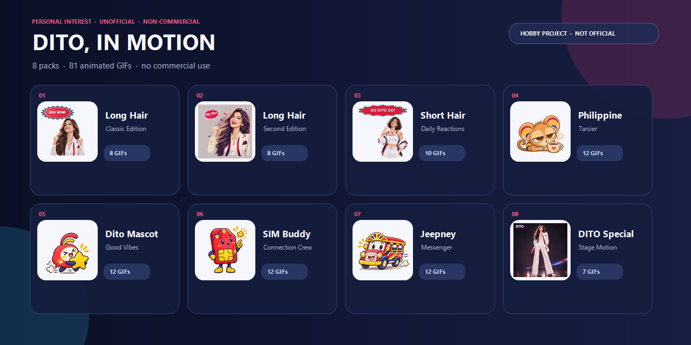

  
  <h1>Unofficial DITO Animated Sticker Packs</h1>
  
<strong>Personal-interest project · unofficial · non-commercial only</strong>

  
8 collections · 81 animated GIF stickers · no commercial use

> **Status:** This is a personal-interest project with no commercial purpose. It is not an official DITO publication and does not claim sponsorship, affiliation, authorization, or endorsement by DITO.

## The collection

Eight expressive packs bring together DITO-themed characters, Filipino-inspired mascots, and everyday chat reactions. Browse a pack, open any GIF to preview it, and download the files you want for non-commercial use.

| # | Pack | Stickers | Browse |
|---|---|---:|---|
| 01 | Long Hair — Classic Edition | 8 | [Open pack](./set1%20long%20hair/) · [Preview sheet](./set1%20long%20hair/PREVIEW.png) |
| 02 | Long Hair — Second Edition | 8 | [Open pack](./set1%20long%20hair%20v2/) · [Preview sheet](./set1%20long%20hair%20v2/PREVIEW.png) |
| 03 | Short Hair — Daily Reactions | 10 | [Open pack](./set2%20short%20hair/) · [Preview sheet](./set2%20short%20hair/PREVIEW.png) |
| 04 | Philippine Tarsier | 12 | [Open pack](./set3%20%20Tarsier/) · [Preview a GIF](./set3%20%20Tarsier/01_Big_Mood.gif) |
| 05 | DITO Mascot — Good Vibes | 12 | [Open pack](./set3%20D/) · [Preview a GIF](./set3%20D/01_You_Got_This.gif) |
| 06 | SIM Buddy — Connection Crew | 12 | [Open pack](./set4%20SIM%20Buddy/) · [Preview a GIF](./set4%20SIM%20Buddy/01_Got_It.gif) |
| 07 | Jeepney Messenger | 12 | [Open pack](./set5%20%20Jeepney%20Messenger/) · [Preview a GIF](./set5%20%20Jeepney%20Messenger/01_All_Aboard.gif) |
| 08 | DITO Special — Stage Motion | 7 | [Open pack](./set6-spec/) · [Preview a GIF](./set6-spec/DITO_crimson_wave.gif) |

## Preview sheets

  
  
  

## Download and use

- **One sticker:** open a pack folder, select a GIF, then use GitHub's download control.
- **All eight packs:** choose **Code → Download ZIP** on the repository page.
- **Commercial use:** not permitted by this repository. The project does not offer commercial licenses.
- **In chat:** these are animated GIF image files. How they can be added or sent as stickers depends on the messaging app and client version. This repository is not a WeChat Sticker Store submission package.

## License and rights

The sticker artwork that project maintainers are authorized to license is shared under **Creative Commons Attribution-NonCommercial 4.0 International (CC BY-NC 4.0)**. Sharing and adaptations are allowed only for non-commercial purposes, with appropriate attribution and a link to the license. This repository does not grant commercial-use permission. See [LICENSE](./LICENSE) and the [official license deed](https://creativecommons.org/licenses/by-nc/4.0/).

The license applies only to rights project maintainers hold. It does not grant third-party trademark rights or third-party publicity, personality, privacy, or image rights. DITO marks, names, logos, source photographs, and identifiable likenesses are not covered unless their rights holders separately authorize them. A disclaimer or non-commercial license is not a substitute for permission. Do not publish assets whose distribution rights are unclear; remove or replace them, or obtain permission first. [Creative Commons explains these limits](https://creativecommons.org/faq/#does-a-creative-commons-license-give-me-all-the-rights-i-need-to-use-the-work).

## 中文说明

这是个人兴趣作品，无商业目的，且不是 DITO 官方发布，也不代表与 DITO 存在关联或获得其背书。这里收录 **8 组、81 个动态 GIF 表情**：包括不同造型的人物、菲律宾眼镜猴、DITO 吉祥物、SIM 小助手、吉普尼信使和特别动作组。

- **下载单张：**进入对应目录，打开 GIF 后使用 GitHub 的下载功能。
- **下载全部：**在仓库主页选择 **Code → Download ZIP**。
- **禁止商业使用：**项目方不以此开展商业活动；仓库授予的 CC BY-NC 4.0 许可仅允许署名后的非商业分享和改作，不允许使用者将素材用于商业目的。本项目不提供商用许可。
- **授权范围：**CC BY-NC 许可仅覆盖项目方有权授权的版权内容，不授予商标权或第三方肖像、隐私等权利。DITO 标识、来源照片、可识别人物影像等，须由相应权利人另行授权。
- **风险说明：**“个人兴趣”“非官方”声明或 CC BY-NC 许可都不能替代素材授权，也不能保证不存在侵权风险。若无法确认某项素材的公开分发权，请先移除/替换或取得许可，再公开仓库。请查看 [LICENSE](./LICENSE) 和[官方许可说明](https://creativecommons.org/licenses/by-nc/4.0/deed.zh-hans)。
- **权利异议：**如权利人认为某个素材不应公开，请在 GitHub Issue 中标明文件路径，维护者会核查并处理。
- 这些文件是 GIF 动图素材，不是微信表情商店专用上传包；在微信中的添加和发送方式可能因客户端版本而异。

## Contributions

Found a broken file, typo, or display issue? Please open an issue. Before proposing artwork or other assets, make sure you have permission to contribute them under the project's license. See [CONTRIBUTING.md](./CONTRIBUTING.md).

Rights concern or removal request? Open an issue and identify the file so the maintainers can review it.

---

DITO and other brand names or marks referenced in the artwork belong to their respective rights holders.
